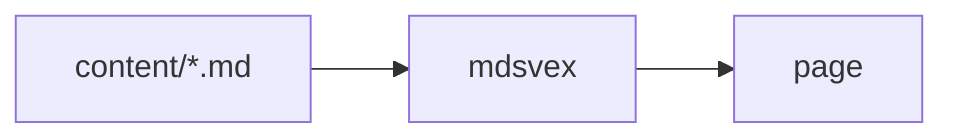

## Authoring model

Use plain markdown (`.md`) for most pages, and switch to `.svx` only when a page needs a live Svelte component inline. Everything else about the two file types is identical: frontmatter, sidecars, GFM, code blocks.

## Frontmatter

Set page metadata directly in the file with YAML frontmatter; no sidecar file is required:

```md filename="content/example.md"
---
title: Example Page
description: Shown in listings and the meta description tag.
order: 5
tags: [guide]
icon: rocket
---

Your content starts here.
```

## Metadata fields

- `title`: Display title
- `description`: Optional summary for listings
- `order`: Sorting number for nav
- `tags`: Optional list for future filtering
- `icon`: Name from the curated icon set, shown in the sidebar and next to the page's `<h1>`. See [Components](/docs/components#page-icons) for the full list of names.

Pages also show a "Last updated on" date, taken from the file's most recent git commit at build time — not from filesystem timestamps, which reset on every fresh clone. There's nothing to set: commit the file and the date follows. If your CI does a shallow clone (GitHub Actions and Cloudflare default to one), most files have no reachable history and the date is simply omitted; fetch full history to get it back (`fetch-depth: 0` in the [GitHub Pages workflow](/docs/deployment/github-pages)).

## Sidecar overrides

A `name.meta.json` file next to `name.md` takes priority over frontmatter for any field it sets. That's useful when you want to tweak nav ordering without touching the prose file, or for content synced in from elsewhere:

```json filename="content/example.meta.json"
{
	"order": 1
}
```

Frontmatter still supplies everything the sidecar doesn't override. `_meta.json`, a separate folder-level file, sits above both; see [Navigation](/docs/navigation) for how that precedence works.

## Headings

Use consistent heading levels so TOC generation and anchor links are predictable.

## GFM formatting

Tables, task lists, strikethrough, and bare-URL autolinks all work out of the box:

| Feature       | Syntax         |
| ------------- | -------------- |
| Table         | pipe-delimited |
| Task list     | `- [ ] todo`   |
| Strikethrough | `~~done~~`     |

- [x] Ship GFM support
- [ ] Ship more of the roadmap

## Code blocks with a filename

Add `filename="..."` to a fence's info string to show a filename header above the code, alongside the built-in copy button every code block gets:

````md
```sh filename="deploy.sh"
echo hello
```
````

## Diagrams and math

Mermaid diagrams use a ` ```mermaid ` fence and render to inline SVG:

````md

````

Mermaid's layout engine needs a real browser, so instead of driving a headless Chromium at build time, the diagram renders in the reader's browser. The mermaid library loads lazily and only on pages that actually contain a diagram; every other page ships none of it, and builds need no browser anywhere — locally, in Docker, or in CI. Diagrams pick the dark or light theme active when the page loads.

LaTeX math uses `$inline$` and `$$block$$` syntax, rendered via KaTeX to static HTML at build time — no client-side JS ships for it:

```md
Inline: $E = mc^2$.

Block:

$$
t = \max\left(1, \left\lceil \frac{w}{200} \right\rceil\right)
$$
```

## Obsidian syntax

Wikilinks (`[[Page]]`), image embeds (`![[diagram.png]]`), `> [!tip]` callouts, `==highlights==`, and `%% comments %%` all work in `.md` and `.svx` files, and `publish: false` or `draft: true` in frontmatter keeps a page out of the build. That means `content/` can be opened directly as an Obsidian vault; see [Obsidian](/docs/obsidian).

## Components

`.svx` files (not `.md`) can import and use Svelte components inline. See the [Components](/docs/components) page for the full built-in set (Callout, Tabs, Steps, Cards, Collapse, Bleed, Banner, FileTree, ImageZoom) and how to import them.

Page styles (paragraph colour, link colour, list markers, inline code, image borders) apply to everything in the page body. A live component or demo that brings its own styles can opt out: wrap it in an element with the `not-prose` class.

```svelte filename="content/demo.svx"
<div class="not-prose">
	<MyWidget />
</div>
```

> **Watch out:** don't put inline code containing `<` or `{` in a heading — plain inline code and inline code anywhere else on the page are both fine. See [Troubleshooting](/docs/troubleshooting#a-heading-with-code-containing-a-tag-or-brace-fails-the-build) for why.

## Reusing content

Use `<include>` to show the same content on more than one page. Give the path of a `.md` or `.svx` page, relative to the current file. Add `#id` to take only part of that page:

```md filename="content/api/player.md"
## Ped methods

<include>./ped.svx#methods</include>
```

What `#id` takes:

- An id on a `<section>` element: everything inside that element.
- A heading's anchor, as shown in the table of contents: that heading and everything under it, down to the next heading at the same level or higher.
- No `#id`: the whole page.

Mark the shared part with a `<section>` when it doesn't line up with a heading:

```md filename="content/api/ped.svx"
## Methods

<section id="methods">

### getArmour

Gets the entity's current armour.

</section>
```

Included content builds as part of the page. Its headings appear in the table of contents, and its text in search and `llms.txt`. If it uses components, svocs adds their imports to the page. Other code in the included page's script block does not come along.

The build fails when the page or the id does not exist, or when a page includes itself.
